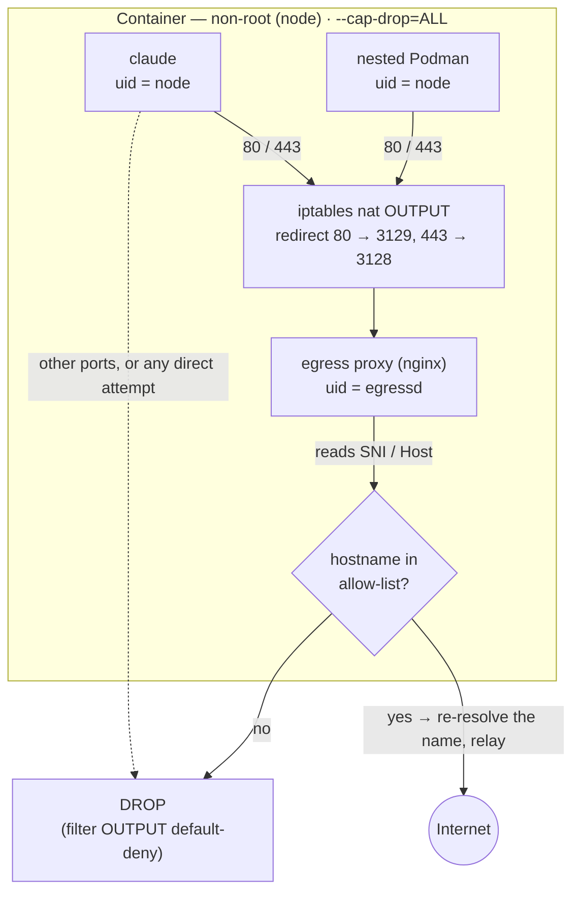

# 02 — Default-deny egress, decided by hostname

Related: [01 — isolation model](01-isolation-model.md),
[05 — nested containers](05-nested-containers-rootless-podman.md),
[06 — bake tools at build time](06-bake-tools-at-build-time.md)

## Context

A YOLO Claude ([04](04-yolo-by-default.md)) that can talk to anywhere is a large
exfiltration and unintended-reach risk. Blocking everything, on the other hand,
would leave it unable to reach the Anthropic API or fetch packages, making the box
useless. So egress is the network half of the isolation model
([01](01-isolation-model.md)): **default-deny, with only the destinations the work
needs opened explicitly.**

The allow-list is written in terms of **domains**. The critical design point is
that the *enforcement* must be by domain too — see the rejected alternative below
for what happens when it is not.

## Decision

`init-firewall.sh` runs at container start via the narrow sudo (needs
`NET_ADMIN`; through `entrypoint.sh`). Enforcement is **by hostname**, in two
layers.

### Two layers

1. **iptables (the wall you cannot break from inside)**
   - `nat OUTPUT` **transparently redirects** all 80/443 traffic to a local proxy
     (80 → 3129, 443 → 3128).
   - `filter OUTPUT` defaults to DROP. The only traffic that leaves directly is
     the proxy's own uid on 80/443.
   - `HTTP_PROXY` / `HTTPS_PROXY` environment variables are **not used**. The
     threat model is "a prompt-injected Claude running inside the box", and a
     control the subject can `unset` is not a control.
   - IPv6 is not covered by the redirect, so `ip6tables` drops everything except
     DNS to keep it from being an open path.

2. **nginx (the layer that decides)**
   - 443: `ssl_preread` reads the **SNI** from the TLS ClientHello and matches it
     against the allow-list. **TLS is never decrypted** (no MITM, so no CA
     distribution and no certificate-verification bypass).
   - 80: matches on the **Host header** (needed because Debian/Ubuntu mirrors use
     plaintext HTTP).
   - On a match, nginx **re-resolves that hostname itself** and relays. The
     destination IP the client asked for is not used to choose the upstream.

### The flow

Only the proxy's uid (`egressd`) is exempt from the default DROP, so it is the one
process that can reach the internet directly; everything the `node` uid emits either
goes through the redirect to the proxy (80/443) or is dropped. This is exactly why
the proxy must **not** share the `node` uid — see the invariants below.

### Invariants (breaking these silently opens everything)

- **The proxy runs under a dedicated uid (`egressd`)**. If it shared the `node`
  uid (the one `claude` runs as), the `--uid-owner` exception would apply to
  `claude` too and 80/443 would pass straight through.
- **If `--uid-owner` is unavailable, startup aborts.** With no owner match the
  exclusion rule does nothing and everything would pass; the script tests whether
  the rule can be added and, on failure, `exit 1` (fail-closed).
- The proxy's working directories are created **at build time** as `root:egressd`
  0775. The container is `cap-drop=ALL` (no CHOWN, no DAC_OVERRIDE), so ownership
  cannot be fixed at runtime.

### The allow-list

Held in `init-firewall.sh`, split into two tiers so that "what is essential" is
legible and cannot be dropped by accident:

- **CORE** — without it Claude Code itself does not run (the Anthropic /
  `claude.ai` / `claude.com` auth, API and update hosts). Always included.
- **OPTIONAL** — grouped by purpose (GitHub, npm/PyPI, container registries + OS
  mirrors for nested Podman, Terraform provider fetch, the Go module proxy).

`ALLOW_DOMAINS` replaces the OPTIONAL set wholesale; `EXTRA_ALLOW_DOMAINS` appends
to it. **CORE is always kept either way**, so you cannot brick the box by dropping
`api.anthropic.com`. Every entry — including anything arriving through those
environment variables — must pass a hostname-shape check before it reaches the
nginx config (injection guard); duplicates are de-duplicated (nginx map keys must
be unique). GitHub's log artifacts live on Azure Blob, allowed by the narrow
pattern `productionresultssa[0-9]+\.blob\.core\.windows\.net` rather than opening
`*.blob.core.windows.net`. The API reaches that storage through
`results-receiver.actions.githubusercontent.com` (an exact host in the GitHub
group), so both are needed for `gh run view --log` to work.

### Startup self-check

The firewall verifies itself at startup; if even one "should be blocked" case gets
through, it `exit 1`s.

| # | Check | Expected |
|---|---|---|
| 1 | `https://example.com` | blocked (SNI not allowed) |
| 2 | `http://example.com` | blocked (Host not allowed) |
| 3 | `https://api.github.com/zen` | reachable |
| 4 | reach `api.github.com` via `--resolve api.github.com:443:192.0.2.1` | reachable (proves the client-supplied IP is ignored and the name is re-resolved) |
| 5 | `deb.debian.org` with a spoofed `Host: example.com` | blocked (host spoofing does not work) |

Check 4 is the direct evidence that DNS drift is gone; check 5, that spoofing is
resisted.

## Rejected alternative: allow by IP (ipset + GitHub meta)

The first design resolved each allowed domain with `dig` at startup and pinned the
resulting IPs into an `ipset` (`hash:net`), with GitHub allowed via the CIDR ranges
from `api.github.com/meta`. The allow-list was written in **domains** but enforced
on **IPs**, and that gap caused real harm:

- **DNS drift (things become unreachable).** CDN-fronted destinations rotate their
  answer IPs on short TTLs (observed: `proxy.golang.org` changing IP within
  seconds; an Azure Front Door name on a 10-second TTL). A startup snapshot cannot
  follow this, so a long-running box gets `no route to host` to an *allowed* host.
- **Shared CDN IPs (too open).** Allowing `production.cloudfront.docker.com` also
  allowed every unrelated site sharing that CloudFront IP. With IP matching you
  cannot open "just one host".
- **Missed allows.** `codeload.github.com` is in none of the meta `web`/`api`/`git`
  ranges, so `github.com` worked while `codeload` was blocked — a state that was
  hard to explain.

Hostname matching closes all three: the enforcement matches the intent, resolution
happens per-connection at the proxy (`valid=30s`), a shared IP no longer implies
access when the SNI/Host differs, and the dependency on the GitHub meta API — and
its fallback branch — is gone.

## Consequences

### Good

- The allow-list's wording and what is actually blocked agree: what you write as a
  domain is guarded as a domain.
- Wherever the box tried to reach is logged **by hostname**
  (`/var/log/egress-proxy/`). For a YOLO box the audit value is significant.
- Nested Podman egress also traverses this outer rule
  ([05](05-nested-containers-rootless-podman.md)).

### Trade-offs and notes

- **The intentional non-allow is the capability boundary.** AWS API endpoints are
  not opened, so Terraform goes as far as `init`/`validate` (schema check, no
  credentials); `plan`/`apply` stay on the operator's machine. *This box verifies
  IaC; it does not apply it.*
- **All outbound other than 80/443 is now blocked.** The old IP approach allowed
  any port to an allowed IP, so SSH (22) to GitHub worked; it no longer does. git
  uses HTTPS + `gh auth git-credential` (configured system-wide in the
  `Dockerfile`), so there is no practical loss. If SSH is ever needed, decide it in
  a new design note.
- **One more moving part.** If nginx dies, 80/443 all fail. That is the fail-closed
  (safe) direction, but availability drops.
- **ECH (Encrypted Client Hello), once widespread, hides the SNI.** That would
  break this approach's premise and require a fresh decision.
- **Plaintext HTTP trusts the Host header.** Spoofing only lets you out "as that
  hostname" (check 5), so it is not a hole, but the signal is not cryptographic —
  same caveat as the SNI side.

## Verification

Confirmed on real hardware (`--cap-drop=ALL` with production-equivalent
capabilities, firewall enabled):

- all five startup self-checks as expected;
- `go get github.com/rs/zerolog@v1.33.0` succeeds via `proxy.golang.org`;
- `deb.debian.org` (plaintext HTTP), `registry.npmjs.org`, `pypi.org`,
  `codeload.github.com`, `objects.githubusercontent.com` all reachable;
- `docker pull alpine:3.20` from a nested Podman container succeeds;
- a direct connection to 22/TCP is blocked.
